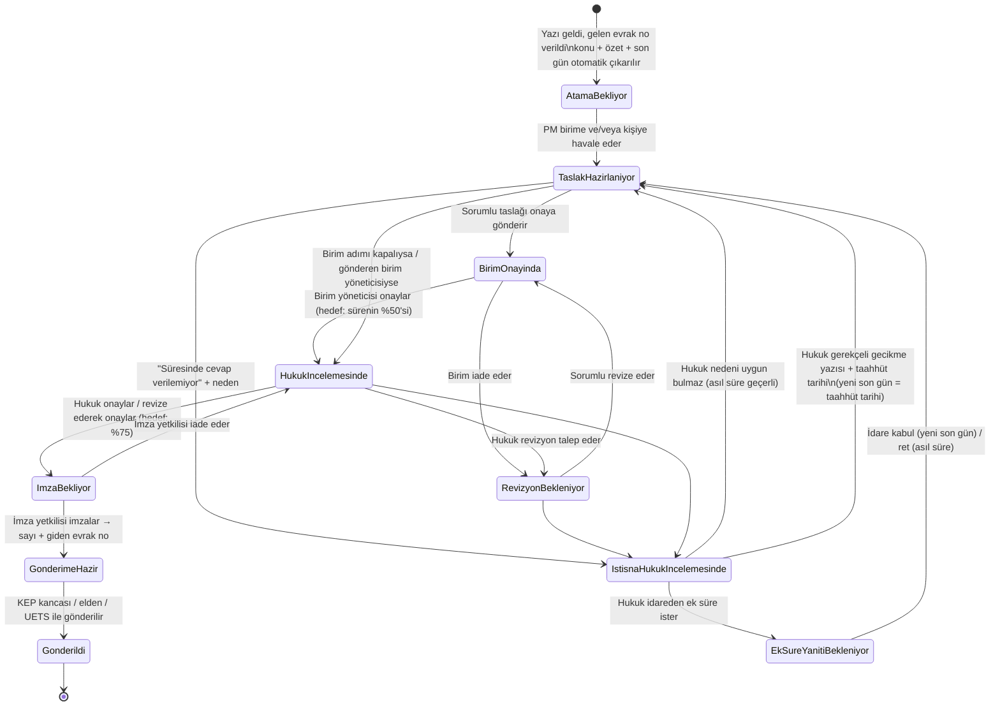

# İdare Yazıları Modülü (.NET 8)

KÖİ/PPP proje şirketlerine **UETS**, **KEP**, **e-Yazışma**, **e-posta** veya **elden/posta** gelen idare yazılarını
kaydeden (gelen/giden evrak defteri), otomatik analiz eden, cevap sürecini
**proje müdürü havalesi → sorumlu taslağı → birim onayı → hukuk → imza yetkilisi → sayı → gönderim** zinciriyle yöneten,
süreleri hatırlatma ve eskalasyonla takip eden ve yazıdan operasyon görevi üreten modül.

## İş akışı



Birim onayı ve imza adımları `OnayAkisi` ayarlarıyla kapatılabilir (kapalıysa sayı gönderim anında verilir).

İstisna sonuçlandığında yazı, istisnanın bildirildiği aşamaya (taslak / revizyon / hukuk) geri döner.
Ek süre kabul edildiğinde veya gecikme bildirildiğinde **%50 / %75 ara tarihleri yeni pencereye göre**
(karar anı → yeni son gün) yeniden hesaplanır ve hatırlatmalar yeni tarihe göre kurulur.

## Süre kuralları

| Kural | Varsayılan | Ayar (`Sureler`) |
|---|---|---|
| Taslak son tarihi | Tebliğ → cevap son günü arasındaki sürenin %50'si | `TaslakOrani` |
| Hukuk son tarihi | %75 | `HukukOrani` |
| Ara tarih yuvarlama | Önceki iş gününün mesai bitimine (18:00) **geriye** yuvarlanır | `AraTarihleriIsGununeCek`, `MesaiBitisSaati` |
| Süre başlangıcı | Tebliğ günü sayılmaz | – |
| "X gün" | Takvim günü | – |
| "X iş günü" | Hafta sonu + resmi tatiller atlanır | `EkTatiller` (dini bayramlar) |
| "X ay" | Tebliğ gününe karşılık gelen ay günü | – |
| Son gün tatile denk gelirse | Uzatılmaz (ihtiyatlı) | `SonGunTatildeIseUzat` |
| Metinde süre yoksa | 15 gün + **"süre teyidi"** uyarısı, PM'e hatırlatma | `VarsayilanCevapSuresiGun` |
| "Yaklaşıyor" hatırlatmaları | 24 saat önce | `OnHatirlatmaSaat` |

> `EkTatiller` içindeki 2026–2027 dini bayram tarihleri (arife dahil) Diyanet takvimine göre kontrol edilmeli ve her yıl güncellenmelidir.

## Otomatik analiz (konu, özet, son gün)

* **Kural tabanlı analiz** (her zaman çalışır): `Konu:` / `Sayı:` satırları, antetten gönderen idare,
  "15 (on beş) gün içinde", "7 iş günü", "en geç 20.11.2026 tarihine kadar", "20 Kasım 2026 tarihine kadar",
  "1 ay içinde", "ivedilikle" gibi ifadeler. Birden fazla süre varsa **en kısası** seçilir.
* **Yapay zekâ analizi** (opsiyonel, `YapayZeka:Etkin=true`): Claude ile daha iyi özet ve süre tespiti; metni
  yalnızca **PDF ekte** olan KEP/UETS yazılarını da okur. Model tarih aritmetiği yapmaz, yalnızca ifadeyi raporlar;
  son günü her zaman `SureHesaplayici` hesaplar. İki yöntem farklı son gün bulursa **erken tarih** seçilir ve
  süre teyidi istenir. Yapay zekâ hata verirse kural tabanlı analize düşülür.
  API anahtarı `ANTHROPIC_API_KEY` ortam değişkeninden (veya `YapayZeka:ApiKey`) okunur.
  Model güvenlik gerekçesiyle bir isteği reddederse sunucu taraflı yedek model devreye girer.
* PM veya hukuk, çıkarılan bilgileri ekrandan **düzeltebilir / teyit edebilir**.

## Roller ve yetkiler

| İşlem | Proje müdürü | Sorumlu (personel) | Birim yöneticisi | Hukuk | İmza yetkilisi | Yönetici |
|---|---|---|---|---|---|---|
| Yazıları görme | Kendi projesi | Kendisine havale edilenler | Birimine havale edilenler | Tümü | İmza bekleyenler + imzaladıkları | Tümü |
| Gelen evrak girişi | Kendi projesi | – | – | ✓ | – | ✓ |
| Havale (birim / kişi) | ✓ | – | Kendi birimi içinde | – | – | ✓ |
| Taslak kaydet / onaya gönder | ✓ | ✓ | – | – | – | ✓ |
| Birim onayı / iade | Birim yoksa ✓ | – | ✓ | – | – | – |
| Hukuk onayı / revizyon / revize ederek onay | – | – | – | ✓ | – | – |
| İmza (sayı verilir) / iade | – | – | – | – | ✓ | – |
| İdareye gönderim | ✓ | ✓ | – | – | – | ✓ |
| "Süresinde cevap verilemiyor" bildirimi | ✓ | ✓ | – | ✓ (hukuk/imza aşamasında) | – | ✓ |
| İstisna kararı (ret / ek süre / gecikme bildirimi) | – | – | – | ✓ | – | – |
| İdarenin ek süre yanıtını kaydetme | ✓ | – | – | ✓ | – | ✓ |
| Yazıdan görev üretme | ✓ | ✓ | ✓ | ✓ | – | ✓ |
| Kullanıcı / birim / proje tanımı | – | – | – | – | – | ✓ |

Birim yöneticisi ayrı bir rol değildir: `Birimler.YoneticiId` alanında tanımlı kişidir. İmza yetkilisinin
`ProjeId` alanı boşsa tüm projeleri, doluysa yalnız o projeyi imzalar.

Her işlem yazının **hareket geçmişine** (kim, ne zaman, ne yaptı) yazılır. Eşzamanlı düzenlemeler sürüm numarasıyla
engellenir (409).

## Hatırlatmalar

Durum her değiştiğinde hatırlatma planı yeniden üretilir; geçersiz kalanlar iptal edilir, gönderilmişlere dokunulmaz.

| Durum | Alıcı | Hatırlatma |
|---|---|---|
| Atama bekliyor | PM | Hemen + 4 saatte bir (3 kez) |
| Taslak hazırlanıyor | Sorumlu (+ PM) | Atandı · taslak süresi yaklaşıyor · taslak süresi doldu |
| Revizyon bekleniyor | Sorumlu | Revizyon talebi · hukuk süresi yaklaşıyor |
| Hukuk incelemesinde | Hukuk ekibi (+ PM) | İnceleme bekliyor · süre yaklaşıyor · süre doldu |
| Hukuk onayladı | PM + sorumlu | Gönderim bekliyor |
| Süre istisnası | Hukuk ekibi | İstisna incelemesi bekliyor |
| Ek süre yanıtı bekleniyor | Hukuk + PM | 2 gün sonra takip · asıl son gün sabahı |
| Birim onayında | Birim yöneticisi (+ PM) | Onay bekliyor · taslak süresi yaklaşıyor / doldu |
| İmza bekliyor | İmza yetkilileri | İmza bekliyor · son günden bir gün önce |
| Gönderime hazır | PM + sorumlu | Gönderim bekliyor · otomatik gönderim hatası |
| Tüm açık durumlar | PM + sorumlu | Son günden bir gün önce ve son gün sabahı (ek süre/gecikme sonrası "taahhüt edilen tarih") |
| **Eskalasyon** | Üst yönetim + birim yöneticisi | Son ana `EskalasyonSaat` (48 saat) kala cevap hâlâ gönderilmediyse |

Kanallar: uygulama günlüğü (her zaman), **SMTP e-posta** (`Smtp:Etkin=true`) ve ekrandaki 🔔 bildirim kutusu.
Yeni kanal (Teams, SMS…) için `IBildirimGonderici` uygulayıp DI'a eklemek yeterli.

## Evrak kaydı, sayı verme ve Word şablonu

* Her gelen yazıya **gelen evrak no** (`GLN-2026-000123`) verilir; giden her yazıya (cevap, ek süre talebi,
  gecikme bildirimi) **giden evrak no** (`GDN-2026-000045`) ve proje bazında sıralı **sayı** (`SH-01-2026/00012`)
  verilir. Biçimler `Numaralandirma` ayarındadır; sayaç veritabanında eşzamanlılık güvenli tutulur.
* Sayı **imza anında** verilir (imza adımı kapalıysa gönderim anında). İmza yetkilisi isterse e-imzalı dosyayı
  (PDF / .imz) yükler (`OnayAkisi:ImzaliDosyaZorunlu` ile zorunlu yapılabilir).
* Taslak ve giden yazılar **kurum Word şablonundan** `.docx` olarak üretilir (`Belge:SablonYolu`). Şablonda
  `{{ProjeAdi}} {{Sayi}} {{Tarih}} {{Muhatap}} {{MuhatapBuyuk}} {{Konu}} {{Ilgi}} {{Metin}} {{ImzaYetkilisi}} {{TaslakIbaresi}}`
  yer tutucuları kullanılır. Varsayılan şablon `GET /api/yonetim/sablon.docx` ile indirilip kurum antetiyle düzenlenebilir.
* **Gönderim kancası** (`IGidenYaziGonderici`): `KEP` kanalı seçildiğinde yazı (Word + imzalı dosya ekleriyle)
  `.eml` olarak KEP giden klasörüne bırakılır (`KepGonderim:GidenKlasor`); KEP istemcisi/entegrasyon servisi
  e-imzayla gönderir. Alıcı adres, gelen KEP iletisinin gönderen adresidir (ekranda değiştirilebilir). Gönderim
  hatası kaydedilir, yazı gönderime hazır kalır ve ilgililere hatırlatma gider. e-Yazışma / UETS / KEP sağlayıcı
  web servisleri için aynı arayüzü uygulayan yeni sınıflar eklenebilir; tanımlı olmayan kanallar "gönderildi" olarak işaretlenir.

## Diğer modüllerle entegrasyon

| Modül | Yöntem |
|---|---|
| **Operasyon modülü** (görevler) | Yazıdan üretilen görevler `SourceSystem = "IdareYazilari"`, `SourceKey = {yazı}/{görev}` ile aktarılır (operasyon modülündeki `OpsTask.SourceSystem/SourceKey` tekil index'iyle uyumlu). `Operasyon:Mod = Cekme`: operasyon modülü `GET /api/entegrasyon/operasyon/gorevler` ile alır, `POST .../gorevler/alindi` ile onaylar. `Mod = Http`: bu modül görevleri `Operasyon:Url` adresine POST eder (409 = zaten var, başarılı sayılır), başarısızlar 10 kez yeniden denenir. |
| **Hukuk / sözleşme modülü** (kart) | Yazılara `SozlesmeReferansi` girilir; kart `GET /api/entegrasyon/sozlesmeler/{referans}/yazilar` ile ilgili yazıları (evrak no, konu, durum, son gün, giden sayı, bağlantı) listeler. |
| **SharePoint** (doküman deposu) | `Dosyalar:Saglayici = SharePoint` ile ekler ve imzalı dosyalar Microsoft Graph üzerinden doküman kitaplığına (`{KokKlasor}/{yıl}/{yazı}/`) yazılır. Uygulama kaydına `Sites.Selected` (önerilen) veya `Sites.ReadWrite.All` uygulama izni verilmelidir. |
| **Entra ID** (kimlik) | `hukuk_modulu` ile aynı kurulum: `Auth:Mode = EntraId`, `AzureAd:TenantId/ClientId`. Kullanıcı ilk girişte e-posta (UPN) ile eşleştirilir, Entra nesne kimliği (oid) kaydedilir. Roller bu modülün `Kullanicilar` tablosunda yönetilir (`/api/yonetim/kullanicilar`). Değiştiren API isteklerinde `X-Idare: 1` başlığı zorunludur (CSRF). |

Entegrasyon uçları `X-Api-Anahtari` başlığıyla korunur (`Entegrasyon:ApiAnahtarlari`, ortam değişkeniyle verilmeli).

> **Ortak onay motoru:** Onay zinciri (birim → hukuk → imza) şu an bu modülün durum makinesinde ve `OnayAkisi`
> ayarlarıyla yapılandırılır. İK modülündeki ApprovalFlow'a bu oturumdan erişilemediği için ona bağlanmadı;
> erişim sağlandığında onay adımları ApprovalFlow'a taşınabilir (süre hedefleri ve hatırlatmalar bu modülde kalır).

## Gelen yazı kanalları

| Kanal | Nasıl |
|---|---|
| **KEP** | KEP istemcisi / entegrasyon servisi iletileri `veri/gelen/kep` klasörüne `.eml` olarak bırakır. Gönderen, konu, tarih, gövde ve ekler okunur; alıcı KEP adresi `Projeler.KepAdresi` ile projeye eşleştirilir. |
| **UETS** | UETS entegrasyonu tebligatları `veri/gelen/uets` klasörüne `.json` (normalleştirilmiş paket) veya `.pdf` olarak bırakır. |
| **e-Yazışma / e-posta / elden / posta** | Ekrandan "+ Yazı Girişi" (metin ve/veya PDF ekleri, idare adresi, lokasyon, sözleşme referansı) ya da `POST /api/yazilar`. |

Klasörler `ArkaPlan:ToplamaAraligiSaniye` aralıkla taranır; işlenen dosyalar `islendi/`, hatalılar `hatali/`
alt klasörüne taşınır. Aynı ileti (`DisReferans`: KEP Message-ID, UETS barkodu) iki kez kaydedilmez.
Sağlayıcının web servisine doğrudan bağlanmak için `IGelenYaziKaynagi` arayüzünü uygulayan yeni bir adaptör yazılabilir.

`.json` paket örneği:

```json
{
  "kaynak": "Uets",
  "disReferans": "UETS-BARKOD-123",
  "projeKodu": "SH-01",
  "gonderenIdare": "Sağlık Bakanlığı",
  "gelenSayi": "E-123/2026",
  "tebligTarihi": "2026-11-10T10:00:00+03:00",
  "metin": "Konu: ...\n... 15 gün içinde ...",
  "ekler": ["tebligat.pdf"]
}
```

## Mimari

```
src/
  IdareYazilari.Domain          Varlıklar, durum makinesi (IdareYazisi), süre hesaplama, tatil takvimi, hatırlatma planlayıcı
  IdareYazilari.Application     İş akışı / kayıt / sorgu / hatırlatma servisleri, yetki kuralları, kural tabanlı analiz
  IdareYazilari.Infrastructure  EF Core (SQLite / SQL Server), UETS/KEP klasör adaptörü, SMTP, Claude analizcisi, arka plan servisleri
  IdareYazilari.Api             Minimal API, Swagger, ekran (wwwroot/index.html)
tests/
  IdareYazilari.Tests           Süre, analiz, iş akışı, hatırlatma birim testleri + HTTP entegrasyon testleri
```

Tüm durum geçişleri `IdareYazisi` aggregate'inin metotlarındadır; geçersiz geçişler `IsKuraliHatasi` fırlatır.

## Çalıştırma

```bash
dotnet run --project src/IdareYazilari.Api
```

Development ortamında `appsettings.Development.json` ile `Auth:Mode = Dev` kullanılır: tarayıcıda
`http://localhost:5xxx` → ekran, `/swagger` → API. İlk çalıştırmada örnek proje, birim, kullanıcı (PM, personel,
birim yöneticisi, hukuk, imza yetkilisi, yönetici) ve yazılar yüklenir (`OrnekVeri: true`). Üst sağdaki kullanıcı
seçiciyle roller arasında geçiş yapılabilir. Entegrasyon uçları için geliştirme anahtarı `gelistirme-anahtari`.

```bash
dotnet test
```

## Başlıca API uçları

| Yöntem | Yol | Açıklama |
|---|---|---|
| GET | `/api/yazilar?sadeceAcik=true&durum=...&arama=...` | Pano listesi (aciliyet sırasına göre) |
| GET | `/api/yazilar/{id}` | Detay + kullanıcının yapabileceği işlemler |
| POST | `/api/yazilar` · `/api/yazilar/dosyali` | Doğrudan yazı girişi (JSON / multipart) |
| POST | `/api/yazilar/{id}/havale` | `{ birimId, sorumluId }` (kişi boşsa birim yöneticisi) |
| POST | `/api/yazilar/{id}/taslak` | `{ icerik, onayaGonder }` |
| POST | `/api/yazilar/{id}/birim-onay` · `birim-iade` | Birim kararı |
| POST | `/api/yazilar/{id}/hukuk-onay` · `revizyon-talebi` · `revize-et-onayla` | Hukuk kararları |
| POST | `/api/yazilar/{id}/imzala` (multipart, isteğe bağlı imzalı dosya) · `imza-iade` | İmza; sayı verilir |
| POST | `/api/yazilar/{id}/idareye-gonder` | `{ kanal, aliciAdres }` |
| GET | `/api/yazilar/{id}/taslak.docx` · `/giden/{gidenId}.docx` | Word belgeleri |
| POST | `/api/yazilar/{id}/gorevler` | `{ baslik, aciklama, sorumluEposta, lokasyon, termin }` |
| POST | `/api/yazilar/{id}/istisna-yazisi-gonder` | Bekleyen ek süre / gecikme yazısını gönder |
| POST | `/api/yazilar/{id}/istisna` | `{ neden, onerilenTarih }` |
| POST | `/api/yazilar/{id}/istisna-reddet` · `ek-sure-talebi` · `gecikme-bildirimi` | Hukukun istisna kararı |
| POST | `/api/yazilar/{id}/ek-sure-yaniti` | `{ yanit: "Kabul" \| "Ret", verilenTarih }` |
| PUT | `/api/yonetim/kullanicilar/{id}` · `birimler/{id}` · `projeler/{id}` | Tanımlar (yönetici) |
| GET | `/api/entegrasyon/sozlesmeler/{ref}/yazilar` | Sözleşme kartı (API anahtarı) |
| GET/POST | `/api/entegrasyon/operasyon/gorevler` · `/alindi` | Operasyon görev aktarımı (API anahtarı) |
| POST | `/api/yazilar/{id}/bilgi-duzelt` | Konu / özet / son gün düzeltme-teyit |
| GET | `/api/bildirimlerim?gun=7` | Kullanıcıya giden hatırlatmalar |

Tüm işlem uçları isteğe bağlı `surumNo` alır (eşzamanlılık kontrolü).

## Canlıya geçmeden önce

1. **Entra ID:** uygulama kaydı (yönlendirme `https://<alan>/signin-oidc`, ID token), `AzureAd:TenantId/ClientId`;
   kullanıcı/birim/proje tanımlarının `/api/yonetim/*` ile girilmesi. Ters vekil arkasındaysa `App:BehindProxy = true`.
2. **Veritabanı:** `Veritabani:Saglayici = SqlServer` + bağlantı cümlesi; `EnsureCreated` yerine EF Core migration.
3. **SharePoint:** Graph uygulama izni, `Dosyalar:SharePoint:*` (gizli değer ortam değişkeniyle / Key Vault).
4. **KEP / UETS / e-Yazışma:** sağlayıcıyla entegrasyon yöntemi (klasör, web servisi) netleştirilmeli; gelen ve
   giden klasörleri KEP istemcisinin klasörleriyle eşleştirilmeli.
5. **Word şablonu:** kurum antetli şablon hazırlanıp `Belge:SablonYolu` ile verilmeli.
6. **Operasyon modülü:** görev alma ucu (`Http`) veya çekme modu için entegrasyon tarafı yazılmalı; API anahtarı paylaşılmalı.
7. **Hukuk modülü kartı:** sözleşme kartına entegrasyon ucunu çağıran bileşen eklenmeli.
8. **Tatil takvimi:** dini bayramlar ve idari izinler yıllık güncellenmeli.
9. **Yapay zekâ:** etkinleştirilecekse KVKK / gizlilik değerlendirmesi yapılmalı.

## Yeni istisnaların eklenmesi

Yeni bir istisna türü (ör. "idare yazıyı geri çekti", "cevap gerekmiyor", "başka yazıyla birleştirildi") için:

1. `IdareYazisi` içine yeni geçiş metodu (durum kontrolü + hareket kaydı),
2. Gerekirse `YaziDurumu` / `IstisnaCozumu` enum değeri,
3. `Yetki.YapilabilirIslemler` içinde kim yapabilir,
4. `HatirlatmaPlanlayici` içinde hangi hatırlatmalar,
5. `YaziIsAkisiServisi` + API ucu + ekran butonu,
6. Birim testi.
