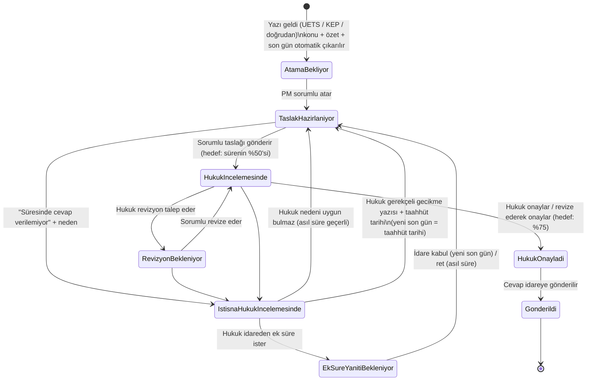

# İdare Yazıları Modülü (.NET 8)

KÖİ/PPP proje şirketlerine **UETS**, **KEP** veya **doğrudan** (elden, posta, e-posta) gelen idare yazılarını
otomatik analiz eden, cevap sürecini **proje müdürü → sorumlu → hukuk → gönderim** akışıyla yöneten ve süreleri
hatırlatmalarla takip eden modül.

## İş akışı



İstisna sonuçlandığında yazı, istisnanın bildirildiği aşamaya (taslak / revizyon / hukuk) geri döner.
Ek süre kabul edildiğinde veya gecikme bildirildiğinde **%50 / %75 ara tarihleri yeni pencereye göre**
(karar anı → yeni son gün) yeniden hesaplanır ve hatırlatmalar yeni tarihe göre kurulur.

## Süre kuralları

| Kural | Varsayılan | Ayar (`Sureler`) |
|---|---|---|
| Taslak son tarihi | Tebliğ → cevap son günü arasındaki sürenin %50'si | `TaslakOrani` |
| Hukuk son tarihi | %75 | `HukukOrani` |
| Ara tarih yuvarlama | Önceki iş gününün mesai bitimine (18:00) **geriye** yuvarlanır | `AraTarihleriIsGununeCek`, `MesaiBitisSaati` |
| Süre başlangıcı | Tebliğ günü sayılmaz | – |
| "X gün" | Takvim günü | – |
| "X iş günü" | Hafta sonu + resmi tatiller atlanır | `EkTatiller` (dini bayramlar) |
| "X ay" | Tebliğ gününe karşılık gelen ay günü | – |
| Son gün tatile denk gelirse | Uzatılmaz (ihtiyatlı) | `SonGunTatildeIseUzat` |
| Metinde süre yoksa | 15 gün + **"süre teyidi"** uyarısı, PM'e hatırlatma | `VarsayilanCevapSuresiGun` |
| "Yaklaşıyor" hatırlatmaları | 24 saat önce | `OnHatirlatmaSaat` |

> `EkTatiller` içindeki 2026–2027 dini bayram tarihleri (arife dahil) Diyanet takvimine göre kontrol edilmeli ve her yıl güncellenmelidir.

## Otomatik analiz (konu, özet, son gün)

* **Kural tabanlı analiz** (her zaman çalışır): `Konu:` / `Sayı:` satırları, antetten gönderen idare,
  "15 (on beş) gün içinde", "7 iş günü", "en geç 20.11.2026 tarihine kadar", "20 Kasım 2026 tarihine kadar",
  "1 ay içinde", "ivedilikle" gibi ifadeler. Birden fazla süre varsa **en kısası** seçilir.
* **Yapay zekâ analizi** (opsiyonel, `YapayZeka:Etkin=true`): Claude ile daha iyi özet ve süre tespiti; metni
  yalnızca **PDF ekte** olan KEP/UETS yazılarını da okur. Model tarih aritmetiği yapmaz, yalnızca ifadeyi raporlar;
  son günü her zaman `SureHesaplayici` hesaplar. İki yöntem farklı son gün bulursa **erken tarih** seçilir ve
  süre teyidi istenir. Yapay zekâ hata verirse kural tabanlı analize düşülür.
  API anahtarı `ANTHROPIC_API_KEY` ortam değişkeninden (veya `YapayZeka:ApiKey`) okunur.
  Model güvenlik gerekçesiyle bir isteği reddederse sunucu taraflı yedek model devreye girer.
* PM veya hukuk, çıkarılan bilgileri ekrandan **düzeltebilir / teyit edebilir**.

## Roller ve yetkiler

| İşlem | Proje müdürü | Sorumlu (personel) | Hukuk | Yönetici |
|---|---|---|---|---|
| Yazıları görme | Kendi projesi | Kendisine atananlar | Tümü | Tümü |
| Doğrudan yazı girişi | Kendi projesi | – | ✓ | ✓ |
| Sorumlu atama / değiştirme | ✓ | – | – | ✓ |
| Taslak kaydet / hukuka gönder | ✓ | ✓ | – | ✓ |
| Onay / revizyon talebi / revize ederek onay | – | – | ✓ | – |
| İdareye gönderildi işaretleme | ✓ | ✓ | – | ✓ |
| "Süresinde cevap verilemiyor" bildirimi | ✓ | ✓ | ✓ (hukuk aşamasında) | ✓ |
| İstisna kararı (ret / ek süre / gecikme bildirimi) | – | – | ✓ | – |
| İdarenin ek süre yanıtını kaydetme | ✓ | – | ✓ | ✓ |
| Proje eşleştirme (eşleşmeyen yazılar) | – | – | – | ✓ |

Her işlem yazının **hareket geçmişine** (kim, ne zaman, ne yaptı) yazılır. Eşzamanlı düzenlemeler sürüm numarasıyla
engellenir (409).

## Hatırlatmalar

Durum her değiştiğinde hatırlatma planı yeniden üretilir; geçersiz kalanlar iptal edilir, gönderilmişlere dokunulmaz.

| Durum | Alıcı | Hatırlatma |
|---|---|---|
| Atama bekliyor | PM | Hemen + 4 saatte bir (3 kez) |
| Taslak hazırlanıyor | Sorumlu (+ PM) | Atandı · taslak süresi yaklaşıyor · taslak süresi doldu |
| Revizyon bekleniyor | Sorumlu | Revizyon talebi · hukuk süresi yaklaşıyor |
| Hukuk incelemesinde | Hukuk ekibi (+ PM) | İnceleme bekliyor · süre yaklaşıyor · süre doldu |
| Hukuk onayladı | PM + sorumlu | Gönderim bekliyor |
| Süre istisnası | Hukuk ekibi | İstisna incelemesi bekliyor |
| Ek süre yanıtı bekleniyor | Hukuk + PM | 2 gün sonra takip · asıl son gün sabahı |
| Tüm açık durumlar | PM + sorumlu | Son günden bir gün önce ve son gün sabahı (ek süre/gecikme sonrası "taahhüt edilen tarih") |

Kanallar: uygulama günlüğü (her zaman), **SMTP e-posta** (`Smtp:Etkin=true`) ve ekrandaki 🔔 bildirim kutusu.
Yeni kanal (Teams, SMS…) için `IBildirimGonderici` uygulayıp DI'a eklemek yeterli.

## Gelen yazı kanalları

| Kanal | Nasıl |
|---|---|
| **KEP** | KEP istemcisi / entegrasyon servisi iletileri `veri/gelen/kep` klasörüne `.eml` olarak bırakır. Gönderen, konu, tarih, gövde ve ekler okunur; alıcı KEP adresi `Projeler.KepAdresi` ile projeye eşleştirilir. |
| **UETS** | UETS entegrasyonu tebligatları `veri/gelen/uets` klasörüne `.json` (normalleştirilmiş paket) veya `.pdf` olarak bırakır. |
| **Doğrudan** | Ekrandan "+ Yazı Girişi" (metin ve/veya PDF ekleri) ya da `POST /api/yazilar`. |

Klasörler `ArkaPlan:ToplamaAraligiSaniye` aralıkla taranır; işlenen dosyalar `islendi/`, hatalılar `hatali/`
alt klasörüne taşınır. Aynı ileti (`DisReferans`: KEP Message-ID, UETS barkodu) iki kez kaydedilmez.
Sağlayıcının web servisine doğrudan bağlanmak için `IGelenYaziKaynagi` arayüzünü uygulayan yeni bir adaptör yazılabilir.

`.json` paket örneği:

```json
{
  "kaynak": "Uets",
  "disReferans": "UETS-BARKOD-123",
  "projeKodu": "SH-01",
  "gonderenIdare": "Sağlık Bakanlığı",
  "gelenSayi": "E-123/2026",
  "tebligTarihi": "2026-11-10T10:00:00+03:00",
  "metin": "Konu: ...\n... 15 gün içinde ...",
  "ekler": ["tebligat.pdf"]
}
```

## Mimari

```
src/
  IdareYazilari.Domain          Varlıklar, durum makinesi (IdareYazisi), süre hesaplama, tatil takvimi, hatırlatma planlayıcı
  IdareYazilari.Application     İş akışı / kayıt / sorgu / hatırlatma servisleri, yetki kuralları, kural tabanlı analiz
  IdareYazilari.Infrastructure  EF Core (SQLite / SQL Server), UETS/KEP klasör adaptörü, SMTP, Claude analizcisi, arka plan servisleri
  IdareYazilari.Api             Minimal API, Swagger, ekran (wwwroot/index.html)
tests/
  IdareYazilari.Tests           Süre, analiz, iş akışı, hatırlatma birim testleri + HTTP entegrasyon testleri
```

Tüm durum geçişleri `IdareYazisi` aggregate'inin metotlarındadır; geçersiz geçişler `IsKuraliHatasi` fırlatır.

## Çalıştırma

```bash
dotnet run --project src/IdareYazilari.Api
```

Tarayıcıda `http://localhost:5xxx` → ekran, `/swagger` → API. İlk çalıştırmada örnek proje, kullanıcı ve yazılar
yüklenir (`OrnekVeri: true`). Üst sağdaki kullanıcı seçiciyle roller arasında geçiş yapılabilir.

```bash
dotnet test
```

## Başlıca API uçları

| Yöntem | Yol | Açıklama |
|---|---|---|
| GET | `/api/yazilar?sadeceAcik=true&durum=...&arama=...` | Pano listesi (aciliyet sırasına göre) |
| GET | `/api/yazilar/{id}` | Detay + kullanıcının yapabileceği işlemler |
| POST | `/api/yazilar` · `/api/yazilar/dosyali` | Doğrudan yazı girişi (JSON / multipart) |
| POST | `/api/yazilar/{id}/sorumlu-ata` | `{ sorumluId }` |
| POST | `/api/yazilar/{id}/taslak` | `{ icerik, hukukaGonder }` |
| POST | `/api/yazilar/{id}/hukuk-onay` · `revizyon-talebi` · `revize-et-onayla` | Hukuk kararları |
| POST | `/api/yazilar/{id}/idareye-gonder` | `{ gidenSayi, kanal }` |
| POST | `/api/yazilar/{id}/istisna` | `{ neden, onerilenTarih }` |
| POST | `/api/yazilar/{id}/istisna-reddet` · `ek-sure-talebi` · `gecikme-bildirimi` | Hukukun istisna kararı |
| POST | `/api/yazilar/{id}/ek-sure-yaniti` | `{ yanit: "Kabul" \| "Ret", verilenTarih }` |
| POST | `/api/yazilar/{id}/bilgi-duzelt` | Konu / özet / son gün düzeltme-teyit |
| GET | `/api/bildirimlerim?gun=7` | Kullanıcıya giden hatırlatmalar |

Tüm işlem uçları isteğe bağlı `surumNo` alır (eşzamanlılık kontrolü).

## Canlıya geçmeden önce

1. **Kimlik doğrulama:** `GelistirmeKimlikDogrulama` (X-Kullanici-Id başlığı) yalnızca geliştirme içindir.
   Kurumun AD / Entra ID / JWT altyapısı bağlanmalı; `HttpMevcutKullanici` e-posta talebinden kullanıcıyı eşleştirir.
2. **Veritabanı:** `Veritabani:Saglayici = SqlServer` + bağlantı cümlesi; `EnsureCreated` yerine EF Core migration.
3. **UETS / KEP:** Sağlayıcıyla entegrasyon yöntemi netleştirilmeli (klasör bırakma, web servisi, IMAP vb.).
4. **Tatil takvimi:** dini bayramlar ve idari izinler yıllık güncellenmeli.
5. **Dosya deposu:** `YerelDosyaDeposu` yerine kurumsal EBYS / belge yönetim sistemi.
6. **Yapay zekâ:** etkinleştirilecekse yazı içeriklerinin dış servise gönderilmesine ilişkin KVKK / gizlilik değerlendirmesi yapılmalı.

## Yeni istisnaların eklenmesi

Yeni bir istisna türü (ör. "idare yazıyı geri çekti", "cevap gerekmiyor", "başka yazıyla birleştirildi") için:

1. `IdareYazisi` içine yeni geçiş metodu (durum kontrolü + hareket kaydı),
2. Gerekirse `YaziDurumu` / `IstisnaCozumu` enum değeri,
3. `Yetki.YapilabilirIslemler` içinde kim yapabilir,
4. `HatirlatmaPlanlayici` içinde hangi hatırlatmalar,
5. `YaziIsAkisiServisi` + API ucu + ekran butonu,
6. Birim testi.
